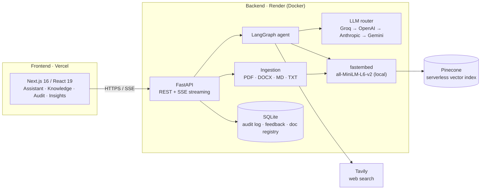
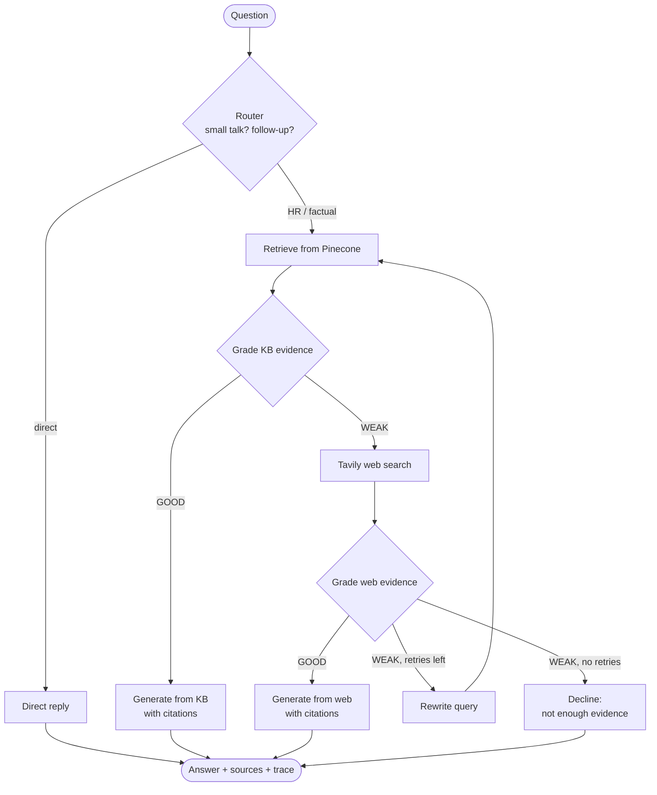

<div align="center">

# PolicyFlow AI

**An agentic RAG copilot that answers employee HR questions from approved company policy, and says so when it can't.**

[](https://policy-flow-ai.vercel.app/)
[](https://policyflow-ai-api.onrender.com/docs)


[Live app](https://policy-flow-ai.vercel.app/) · [API docs (Swagger)](https://policyflow-ai-api.onrender.com/docs) · [Health check](https://policyflow-ai-api.onrender.com/api/health)

</div>

> [!NOTE]
> The API runs on Render's free tier, which sleeps after 15 idle minutes. If the first question takes about a minute, the server is waking up. Later questions stream back in seconds.

---

## Table of contents

- [The problem](#the-problem)
- [Why plain RAG isn't enough](#why-plain-rag-isnt-enough)
- [The solution](#the-solution)
- [Architecture](#architecture)
- [How the agent decides](#how-the-agent-decides)
- [Engineering highlights](#engineering-highlights)
- [Tech stack](#tech-stack)
- [Product tour](#product-tour)
- [Try it](#try-it)
- [Run it locally](#run-it-locally)
- [Testing and CI](#testing-and-ci)
- [API reference](#api-reference)
- [Configuration](#configuration)
- [Deployment](#deployment)
- [Repository layout](#repository-layout)
- [Roadmap](#roadmap)

---

## The problem

**PeoplePrime Technologies** (a fictional 5,000-person company) keeps its leave policies, remote-work rules, payroll details, benefits, onboarding steps and code of conduct in a large internal HR knowledge base. The information exists, but employees still message HR with the same questions, because:

- **Keyword search returns ten documents, not one answer.** Employees can't tell which policy applies to them.
- **A generic chatbot invents things.** It answers confidently even when there is no company evidence behind it. In HR, a made-up answer about leave or payroll is worse than no answer.
- **Some questions need current public information**, such as a newly announced public holiday, that the private handbook doesn't have yet.

> **The business need:** fast HR answers that are **grounded, trustworthy and transparent**, drawn from approved company knowledge whenever possible.

The full brief is in [`backend/docs/Enterprise_HR_Agentic_RAG_Problem_Statement_DigitalOcean.pdf`](backend/docs/Enterprise_HR_Agentic_RAG_Problem_Statement_DigitalOcean.pdf).

## Why plain RAG isn't enough

| Plain RAG | What goes wrong in practice | What PolicyFlow AI does instead |
| --- | --- | --- |
| Retrieve once, then generate | Weak or unrelated chunks still produce a confident answer | **Grades the evidence** before generating anything |
| Fixed pipeline | Every question takes the same path | **Conditional routing** with LangGraph |
| Private knowledge base only | Can't answer when the handbook has a gap | **Controlled web fallback** through Tavily, graded as well |
| One shot | A poorly phrased question gets a poor result | **Rewrites the query and retries** |
| Black box | Nobody can see why it answered | **Live decision trace, citations and an audit log** |

## The solution

PolicyFlow AI is a full-stack, deployed product, not a notebook demo. An employee asks a question in plain language. A LangGraph agent decides where the answer should come from, checks whether the evidence is good enough, and streams back a grounded answer with citations and a step-by-step trace of how it got there.

**Example 1: the answer is in the handbook**

> *"How many annual leave days do employees receive?"*
>
> Router → Retrieve KB → Grade: **GOOD** → *"Full-time employees receive **20 days** of paid annual leave per calendar year…"*, cited to *Company HR Handbook — Annual Leave*. No web search needed.

**Example 2: the handbook doesn't cover it**

> *"What is the latest government public-holiday announcement for our location?"*
>
> Router → Retrieve KB → Grade: **WEAK** → Tavily web search → Grade web: **GOOD** → Answer with web citations, clearly labelled as external.

**Example 3: there is no reliable evidence**

> Router → KB **WEAK** → Web **WEAK** → Rewrite query and retry → still **WEAK** → **The agent declines** and points the employee to HR instead of guessing.

## Architecture



The diagram below is the original target design from the brief. The shipped system follows the same agent flow. Hosting moved from DigitalOcean to Render (API) and Vercel (web), using the same Docker images. See [Deployment](#deployment).

<details>
<summary>Original design diagram</summary>


</details>

### Request lifecycle

1. The browser sends the question and recent chat history to `POST /api/chat/stream`.
2. FastAPI opens a Server-Sent Events stream and runs the LangGraph agent.
3. Each node writes `trace` events as it finishes, so the UI shows the agent's reasoning live.
4. Once a source is chosen, a `meta` event delivers the citations, then the answer streams in token by token.
5. The final state (answer, route, provider, latency, trace, citations) is written to SQLite and a `done` event returns the query ID used for feedback.

## How the agent decides



The graph is defined in [`backend/app/rag/workflow.py`](backend/app/rag/workflow.py). Some details:

- **Two-stage evidence grading.** Chunks below `MIN_RELEVANCE_SCORE` (0.25) are dropped. If the best chunk scores above `STRONG_RELEVANCE_SCORE` (0.6) it is accepted without an LLM call. Only the uncertain middle band goes to an LLM grader. This saves a model call on most well-matched questions.
- **Follow-up questions are rewritten into standalone ones.** "What about part-time staff?" becomes "How many annual leave days do part-time employees receive?" before retrieval. The trace shows how the question was interpreted.
- **Routing and retrieval run in parallel.** While the router LLM classifies the question, the Pinecone search is already running. If the route is `kb`, the results are ready. If not, the task is cancelled.
- **Small talk skips the LLM router.** A regex catches greetings and thanks, so "hi" never costs a classification call.
- **Prompts forbid speculation.** Answers must cite documents by name and say plainly when a policy doesn't cover something ([`prompts.py`](backend/app/rag/prompts.py)).

## Engineering highlights

### Multi-provider LLM router with failover

[`backend/app/llm/providers.py`](backend/app/llm/providers.py) puts Groq, OpenAI, Anthropic and Gemini behind one interface, with an ordered list of models for each provider and two tiers:

- **`fast` tier** for routing, grading and rewriting (short outputs, small models)
- **`main` tier** for the final streamed answer

Failures are classified, and each kind gets a different cooldown:

| Failure | Response |
| --- | --- |
| `401 / 402 / 403`, invalid key, no credit | Whole provider cooled down for 10 minutes |
| `404`, model decommissioned | Only that model cooled down |
| `429` rate limit | That model cooled down, respecting `Retry-After` (capped at 90s) |
| Timeout or other error | Short cooldown, then the next candidate is tried |

Streaming fails over too: if a provider errors **before the first token**, the router moves to the next provider without the user noticing. Providers are probed in parallel at startup, and `/api/health` reports each one's live status. The app works with **any subset** of the four keys.

### Production-minded backend

- **Non-blocking startup.** The embedding model load, Pinecone connection and knowledge-base seeding run in a background thread. The API is healthy immediately and reports `knowledge_base.status` (`loading → ready`).
- **Self-healing document registry.** On boot, the SQLite registry is reconciled with the vectors actually in Pinecone, so redeploys on ephemeral disks don't lose track of documents.
- **Structure-aware chunking.** Markdown and DOCX are split by heading, PDFs by page. Every chunk carries `title`, `section` and `page` metadata, so citations point to *"Company HR Handbook — Annual Leave"* rather than "chunk 17".
- **Local embeddings.** `fastembed` runs `all-MiniLM-L6-v2` on ONNX inside the container. It needs no embedding API key, has no per-query cost, and the model is baked into the Docker image at build time to avoid cold downloads.
- **Admin-gated writes.** Upload and delete require an `X-Admin-Key`, compared in constant time (`secrets.compare_digest`). Uploads are checked for type and size.
- **Full audit trail.** Every question is stored with its answer, source, provider, latency, rewritten query, trace and citations, along with thumbs-up/down feedback.

### Frontend

- Token-by-token streaming over SSE using a hand-written, unit-tested stream parser ([`frontend/src/lib/api.ts`](frontend/src/lib/api.ts))
- A collapsible **decision trace** on every answer, showing each step with its timing
- Source chips that tell private-KB citations (section, page, relevance score) apart from web citations
- `⌘K` / `Ctrl+K` command palette, light and dark themes, responsive layout
- Insights dashboard (KB vs. web vs. declined ratio, provider usage, feedback) and an audit log filterable by source

## Tech stack

| Layer | Technology |
| --- | --- |
| **Agent orchestration** | LangGraph (state machine with conditional edges, custom stream writer) |
| **LLMs** | Groq (`gpt-oss-120b`, Qwen), OpenAI, Anthropic Claude, Google Gemini, via LangChain |
| **Retrieval** | Pinecone serverless, fastembed `all-MiniLM-L6-v2` (384-dim) |
| **Web search** | Tavily |
| **Backend** | FastAPI, Pydantic Settings, SSE, SQLite |
| **Ingestion** | pypdf, python-docx, LangChain text splitters |
| **Frontend** | Next.js 16 (App Router), React 19, Tailwind CSS 4, SWR, cmdk, react-markdown |
| **Testing** | pytest, Vitest |
| **DevOps** | Docker (multi-stage, non-root, healthchecks), Docker Compose, GitHub Actions, Render Blueprint, Vercel |

## Product tour

| Page | What it's for |
| --- | --- |
| **Overview** | Assistant health, knowledge-base status and recent activity at a glance |
| **Assistant** | Chat with streamed answers, citations, decision trace and feedback |
| **Knowledge Base** | Browse indexed documents, and upload or delete them (admin) |
| **Audit Log** | Every question, answer, source, latency and trace |
| **Insights** | Source mix, provider usage and answer-quality feedback |
| **Workflow** | Visual explainer of how the agent decides |
| **Settings** | Live provider status, appearance and admin key |

## Try it

Open **[policy-flow-ai.vercel.app](https://policy-flow-ai.vercel.app/)** and ask:

| Question | Expected path |
| --- | --- |
| *How many annual leave days do I get?* | Private KB → grounded answer |
| *What's the process for requesting remote work?* | Private KB → step-by-step answer |
| *And how many of those can I carry over?* | Follow-up rewritten to a standalone question → Private KB |
| *What are the latest public holidays announced in Bangladesh?* | KB weak → web search → web-grounded answer |
| *Hi, what can you do?* | Direct reply, no retrieval |

Expand the **Agent workflow** panel above any answer to see each decision the agent made and how long it took.

## Run it locally

### With Docker (recommended)

Requirements: Docker.

```bash
cp backend/.env.example backend/.env   # add at least one LLM key, plus Pinecone (and Tavily for web search)
docker compose up --build
```

- Web app: http://localhost:3000
- API: http://localhost:8000, with interactive docs at http://localhost:8000/docs

The web container waits until the API reports healthy. SQLite, uploads and the seed knowledge base live in the `api-data` volume and persist between runs. `NEXT_PUBLIC_API_URL` is compiled into the browser bundle at build time and defaults to `http://localhost:8000`.

### Without Docker

Requirements: Python 3.13+, Node.js 20+.

```bash
cd backend
python -m venv .venv
source .venv/bin/activate              # Windows: .venv\Scripts\activate
pip install -r requirements.txt
python prepare.py                      # pre-download the embedding model
uvicorn app.main:app --reload --port 8000
```

```bash
cd frontend
cp .env.example .env.local
npm install
npm run dev
```

On first start, the backend seeds Pinecone with the bundled handbook in [`backend/data/knowledge_base`](backend/data/knowledge_base) if the index is empty.

## Testing and CI

```bash
cd backend
pip install -r requirements-dev.txt
pytest
```

```bash
cd frontend
npm test
npm run typecheck
```

- **Backend:** 55 offline tests covering the agent's routing and grading branches, retry and decline paths, the LLM router's failover and cooldown rules, ingestion and chunking, bootstrap reconciliation and the API endpoints. There are also 7 opt-in live tests against real providers.
- **Frontend:** Vitest suites for the SSE stream parser and utilities.
- **CI:** [`.github/workflows/docker.yml`](.github/workflows/docker.yml) validates the Compose file and builds both Docker images on every push and pull request.

## API reference

Full interactive docs: **[policyflow-ai-api.onrender.com/docs](https://policyflow-ai-api.onrender.com/docs)**

| Method | Path | Purpose |
| --- | --- | --- |
| `POST` | `/api/chat/stream` | Streamed answer as Server-Sent Events (`trace`, `meta`, `token`, `done`, `error`) |
| `POST` | `/api/chat` | Same pipeline, single JSON response |
| `POST` | `/api/feedback` | Thumbs up or down on an answer |
| `GET` | `/api/stats` | Usage statistics |
| `GET` | `/api/logs` | Paginated audit log, filterable by source |
| `GET` | `/api/documents` | Knowledge-base contents |
| `GET` | `/api/admin/verify` | Check an admin key |
| `POST` | `/api/ingest` | Upload and index a document (admin) |
| `DELETE` | `/api/documents/{doc_id}` | Remove a document and its vectors (admin) |
| `GET` | `/api/health` | Liveness, KB readiness and per-provider status |

```bash
curl -N -X POST https://policyflow-ai-api.onrender.com/api/chat/stream \
  -H "Content-Type: application/json" \
  -d '{"question": "How many annual leave days do employees receive?"}'
```

## Configuration

All settings are environment variables, documented in [`backend/.env.example`](backend/.env.example).

| Variable | Purpose |
| --- | --- |
| `GROQ_API_KEY`, `OPENAI_API_KEY`, `ANTHROPIC_API_KEY`, `GEMINI_API_KEY` | LLM providers. Any subset works, and unset or placeholder keys are ignored |
| `LLM_PROVIDERS` | Failover order, e.g. `groq,openai,anthropic,gemini` |
| `PINECONE_API_KEY` | Required for retrieval. The index is created automatically if missing |
| `TAVILY_API_KEY` | Enables web fallback. Without it, weak KB evidence leads to a decline |
| `ADMIN_API_KEY` | Enables upload and delete |
| `TOP_K`, `MIN_RELEVANCE_SCORE`, `STRONG_RELEVANCE_SCORE`, `MAX_RETRIES` | Retrieval and grading behaviour |
| `CORS_ORIGINS`, `CORS_ORIGIN_REGEX` | Allowed frontend origins |

## Deployment

| Component | Platform | How |
| --- | --- | --- |
| API | **Render** (Docker web service) | [`render.yaml`](render.yaml) Blueprint builds `backend/Dockerfile` and health-checks `/api/health` |
| Web | **Vercel** | Root directory `frontend`, with `NEXT_PUBLIC_API_URL` set to the Render URL |
| Vectors | **Pinecone** serverless | `policyflow-hr-kb` index, `hr-docs` namespace |

The brief targeted DigitalOcean. Because everything ships as standard Docker images (Python 3.13 slim, non-root, `HEALTHCHECK`; Next.js standalone on Node 22 alpine), the same `docker-compose.yml` runs unchanged on a DigitalOcean Droplet or any other Docker host. Render and Vercel were chosen for the live demo to get managed TLS, preview deployments and free hosting.

Step-by-step instructions are in **[DEPLOYMENT.md](DEPLOYMENT.md)**.

## Repository layout

```
PolicyFlow-AI/
├── backend/                  FastAPI service (Render)
│   ├── app/
│   │   ├── api/              routes, SSE streaming, schemas
│   │   ├── core/             settings and logging
│   │   ├── llm/              multi-provider router with failover
│   │   ├── rag/              LangGraph workflow, prompts, embeddings, Pinecone
│   │   └── services/         bootstrap, ingestion, SQLite storage
│   ├── data/knowledge_base/  seed HR handbook and runbook
│   ├── docs/                 problem statement and design diagram
│   └── tests/                pytest suite
├── frontend/                 Next.js app (Vercel)
│   └── src/
│       ├── app/              pages: assistant, knowledge, activity, insights, workflow, settings
│       ├── components/       chat, trace, knowledge, shell, ui
│       └── lib/              API client, SSE parser, hooks, types
├── docker-compose.yml        full stack for local or self-hosted runs
├── render.yaml               Render Blueprint
└── .github/workflows/        Docker build CI
```

## Roadmap

- Role-based access with SSO in place of a single admin key
- Metadata filtering by department, region or employment type, so answers match the employee's situation
- Postgres in place of SQLite for multi-instance deployments
- An offline evaluation set (faithfulness, answer relevance) run in CI
- Hybrid retrieval (BM25 + dense) and reranking

---

<div align="center">

Built by **Md Shahadat Hossain** · [Live demo](https://policy-flow-ai.vercel.app/) · [GitHub](https://github.com/Emon3469/PolicyFlow-AI)

</div>
